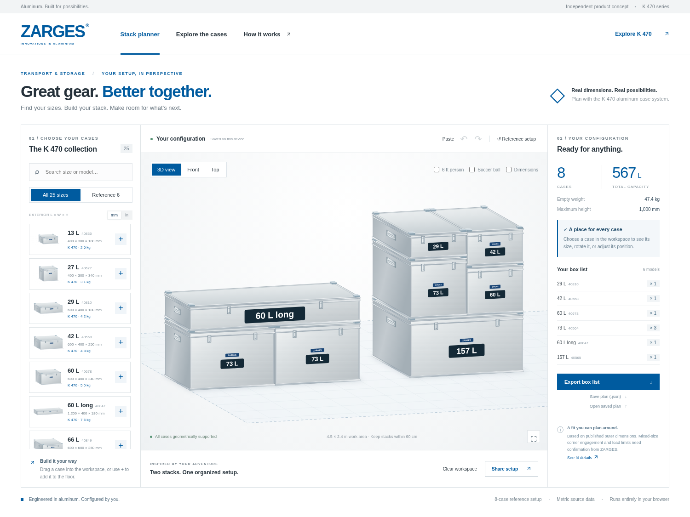
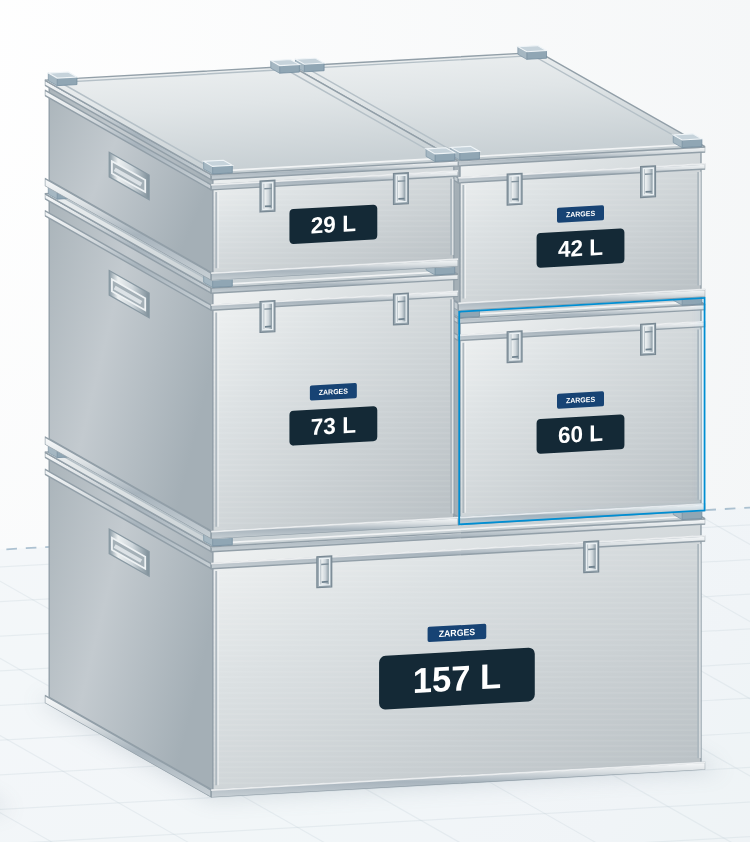
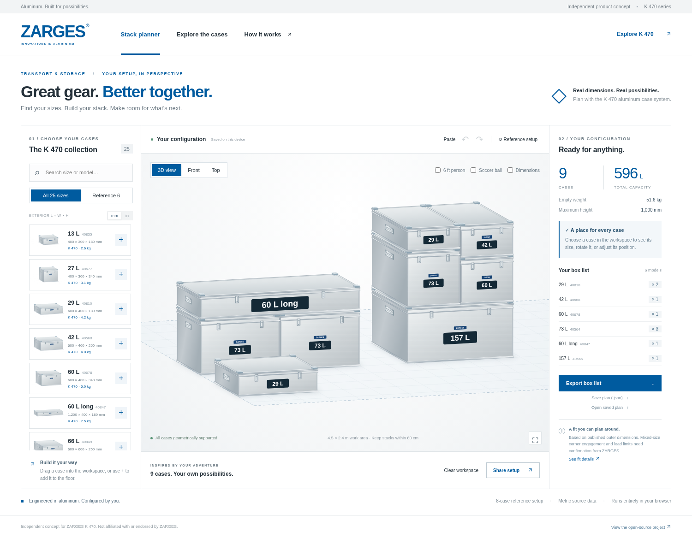
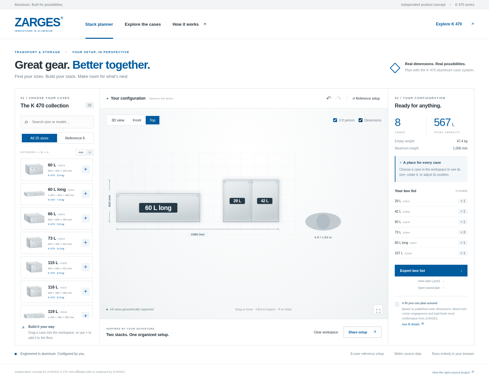
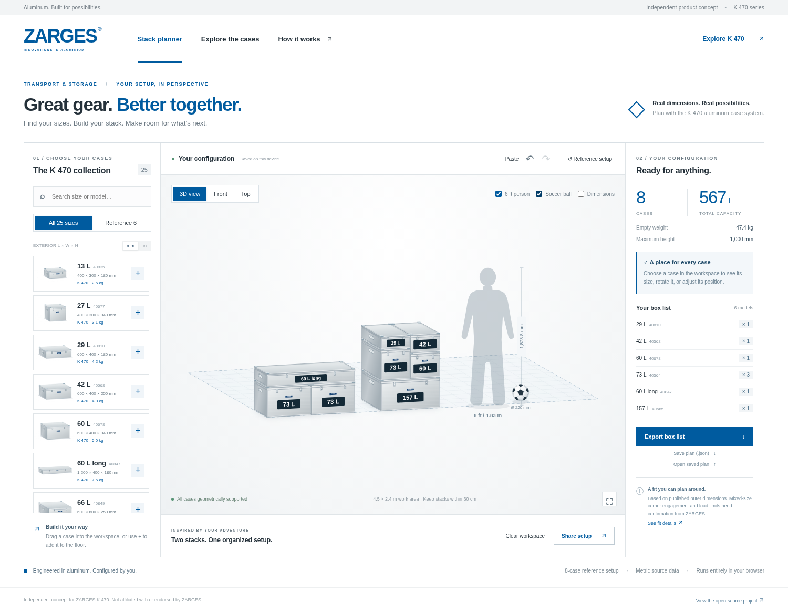
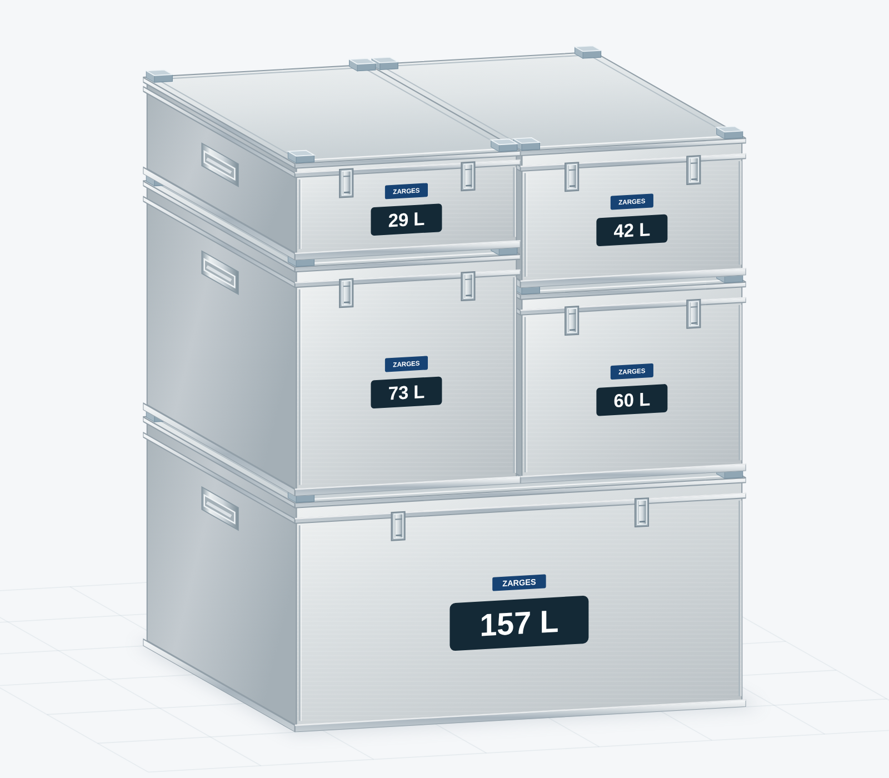
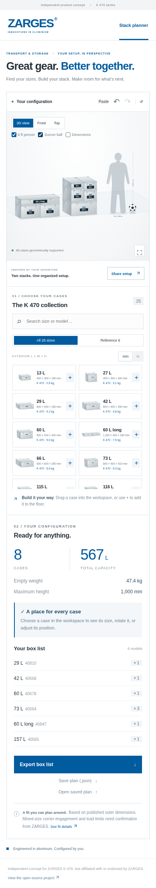

# ZARGES K 470 Stack Planner

A browser-based way to answer a simple question: **which cases fit together, and how much space will my setup take?**

Choose from all **25 standard K 470 Universal Box sizes (13–829 L)**, drag dimensionally accurate cases into a stack, inspect the result from three views, and export a model-by-model box list. Optional **6-foot / 1828.8 mm person** and **22 cm soccer ball** references make scale easier to judge. The default scene recreates the two stacks in the original reference: **8 cases, 567 L, 47.4 kg empty**.

An independent, open-source product concept by Gavin Wright. Not affiliated with or endorsed by ZARGES.



## See it in action

[**Watch the video demo — MP4**](https://github.com/gavinwright-engr/ZargesConfigurator/blob/main/docs/media/demo.mp4)

[](https://github.com/gavinwright-engr/ZargesConfigurator/blob/main/docs/media/demo.mp4)

The recording opens with **both the person and soccer ball off**, giving the cases the full workspace. It demonstrates visible-edge selection, the complete catalog, copy/paste, dimensions, front/top/3D views, actual drag-and-drop stacking, CSV export, and fit information. The optional scale references appear briefly later in the tour. [Reproduce the screenshots and recording](docs/media/README.md).

## Run it

Requires Node.js 20 or newer. The app has **no runtime dependencies** and needs no installation or build step for local use.

```sh
git clone https://github.com/gavinwright-engr/ZargesConfigurator.git
cd ZargesConfigurator
npm start
```

Open **http://localhost:3000**. To produce a deployable static folder, run `npm run build` and serve `dist/` from any static host. Relative asset paths also support a GitHub Pages project subdirectory. Opening the HTML directly with `file://` does not support its ES modules.

## What you can do

- **Build a stack:** drag from the catalog, or add a case with + and move it in the workspace. Edges snap; overlapping and unsupported placements are rejected.
- **Explore the full catalog:** browse or search all 25 standard K 470 sizes, or filter to the six models in the reference arrangement. The catalog scrolls independently of the workspace.
- **Place precisely:** select a case to rotate, remove, or move it in 10 mm steps. The highlight follows its visible edges, including front/side/lid seams in 3D; neighboring cases hide covered edges. Use the **Place on** surface selector to stack cases with a keyboard or touch screen.
- **Copy and paste:** select a case and use **Ctrl/Cmd+C**, then **Ctrl/Cmd+V**, or the **Copy** and **Paste** buttons. Each copy keeps its model and rotation and appears in a nearby clear floor spot. Pasting is undoable; text fields retain normal text editing.
- **Place cases in front or behind:** the **4.5 × 2.4 m** floor leaves **900 mm of free space on each side** of the reference setup in the depth direction. Drag new cases into either area. The floor stays fixed while you build; the camera keeps the cases close.
- **Keep cases together:** the height limit is **3 m**, and gaps between neighboring stacks can be at most **60 cm**. Distant drops stay in their original position; new cases use nearby rows. These are planner settings, not manufacturer limits.
- **Compare sizes:** switch between perspective, front, and top views; show dimensions; toggle millimeters/inches. The model always retains millimeter precision.
- **Get a sense of scale:** independently toggle the **6-foot person** and a **22 cm soccer ball**. The camera fits the cases and enabled references; hiding both gives a closer view. Selecting a case keeps the camera and canvas size fixed; the details panel scrolls independently.
- **Keep your work:** automatic device-local saving, undo/redo, JSON import/export, and a URL that restores the configuration.
- **Prepare an order discussion:** export a CSV grouped by manufacturer model, quantity, capacity, dimensions, empty mass, and official product link.

Keyboard: Tab + Enter selects a case; **R** rotates; **Delete** removes; arrow keys move 10 mm; **Ctrl/Cmd+C / V** copies / pastes; **Ctrl/Cmd+Z** undoes, **Ctrl/Cmd+Shift+Z** redoes. Move upper cases before moving or removing their supports. The surface selector provides stacking without dragging.

## Screenshots

**Visible-edge selection.** The selected 60 L case is outlined where it is visible; neighboring boxes hide the covered edges.



**Space to build.** New cases can be placed in front of or behind the reference setup.



**Footprint and dimensions.** Top view makes the layout easy to compare.



<details>
<summary>Optional scale reference and unselected stack detail</summary>





</details>

<details>
<summary>Responsive mobile screenshot</summary>



</details>

## The pictured cases

The table below lists the six reference models; the app also includes the other 19 standard sizes. The data uses ZARGES Europe's published **maximum outside dimensions**, consistently across every model. Displayed inches are conversions of that same dataset. Regional product pages use different dimensional conventions; see the [complete 25-model table and source notes](docs/product-data.md). Special IP65/IP67 variants, other ZARGES series, and custom sizes are outside this standard K 470 catalog.

| Capacity | Model | Exterior L × W × H (mm) | Empty mass | Reference quantity |
| --- | --- | --- | --- | --- |
| 29 L | 40810 | 600 × 400 × 180 | 4.2 kg | 1 |
| 42 L | 40568 | 600 × 400 × 250 | 4.8 kg | 1 |
| 60 L | 40678 | 600 × 400 × 340 | 5.0 kg | 1 |
| 73 L | 40564 | 600 × 400 × 410 | 5.3 kg | 3 |
| 60 L long | 40847 | 1200 × 400 × 180 | 7.5 kg | 1 |
| 157 L | 40565 | 800 × 600 × 410 | 10.0 kg | 1 |

**Stack 1:** two 73 L cases, side by side, under the long 60 L case. Nominal envelope: **1200 × 400 × 590 mm**.

**Stack 2:** a 157 L base under a rotated 73 L / 60 L pair, topped by 29 L / 42 L respectively. Nominal envelope: **800 × 600 × 1000 mm**. The unequal middle heights are exactly offset by the two top case heights.

### Geometric fit versus confirmed stacking

ZARGES USA explicitly lists the four 600 × 400 mm models as stacking with each other. The two mixed-size reference arrangements have full rectangular support using the published outer envelopes, but **their mechanical corner engagement is not manufacturer-confirmed in the sources consulted**.

This app is a planning model, not a load or stability certification. It does not simulate feet/lid profiles, nested height reductions, payloads, center of gravity, restraints, or transport loads. Ask ZARGES to confirm the long-case bridge and two-on-one combinations before relying on them for an order. [Full product sources and limitations](docs/product-data.md).

## Small modules, easy to reuse

```text
index.html                 Accessible app shell
src/
  catalog.js               Sourced product data and the reference arrangement
  stacking.js              Pure geometry, snapping, collision and support checks
  workspace.js             Bounded stage, nearby floor placement and old-plan repair
  clipboard.js             Validated model/rotation clipboard format
  renderer.js              SVG aluminum cases, projections and drag previews
  plans.js                 Validated plan format, sharing and CSV export
  app.js                   Interaction, undo/redo, storage and interface updates
  styles.css               Responsive ZARGES-inspired visual treatment
tests/                     Geometry and plan validation checks (Node built-in runner)
scripts/                   Static server/build, browser checks, video recording
docs/                      Product evidence, integration guide and demo media
.github/workflows/         Automated checks and optional Pages deployment
```

The geometry and product catalog are independent of the DOM and renderer. ZARGES could integrate those modules into an existing product page, replace the SVG renderer with CAD assets, and map the CSV quantities to its commerce catalog. [Architecture and integration examples](docs/architecture.md).

The visual design uses the brand's aluminum product character, blue accents, white space, technical product cards, and clear typography. The case artwork is original procedural SVG; it is illustrative rather than manufacturer CAD. Existing ZARGES trademarks remain their owners' property.

## Validation

```sh
npm test                   # Dependency-free geometry and plan checks
npm run build              # Static distribution

# Optional development-only browser tooling:
npm ci
npx playwright install --with-deps chromium
npm start                  # Keep running in one terminal
npm run test:browser       # In another terminal
```

Tests cover the reference layout, support and collisions, workspace boundaries and spacing, old-plan repair, clipboard validation, plan round trips, drawing order, and physical scale references. Browser checks exercise real pointer stacking, distant-drop rejection, copy/paste shortcuts and buttons, the full catalog, stable selection, keyboard placement, downloads, imports, sharing, persistence, and mobile layout. Close-up checks inspect all 25 models in both rotations and front/3D views for label containment and overlap. The app loads no remote fonts, analytics, product images, or services.

## Publish

Host the `dist/` output on any static hosting service. For GitHub Pages:

1. In repository **Settings → Pages**, choose **GitHub Actions** as the source.
2. Run **Actions → Deploy to GitHub Pages → Run workflow**.
3. Use the URL returned by the deployment workflow.

The Pages workflow is manual so a normal code push does not implicitly publish a site. The checks workflow runs on pushes and pull requests. Shared links work for anyone who can access the same deployment; a localhost link is only useful on that machine.

## License

[MIT](LICENSE). Contributions and integration are welcome. For a production product integration, first replace illustrative fit assumptions with manufacturer-approved stacking interfaces and load guidance.
